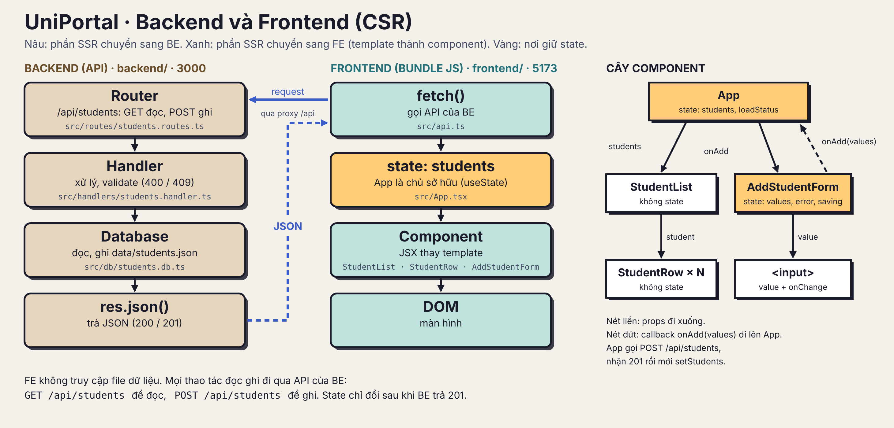

# UniPortal - Student List dạng client-rendered

Báo cáo bài tập tuần 2 của nhóm 2. Ứng dụng dựng màn hình Student List ở phía client
bằng React, không dùng API và không dùng database.

Stack: React 19, Vite 8, TypeScript. Danh sách sinh viên nằm trong React state.

## 1. Thông tin nhóm

| STT | Họ và tên | MSSV |
| --- | --- | --- |
| 1 | Nguyễn Anh Khôi | 24127430 |
| 2 | Nguyễn Tấn Hiệu | 24127373 |
| 3 | La Anh Hào | 24127361 |
| 4 | Trần Nguyễn Tuấn Minh | 24127084 |

## 2. Yêu cầu đề bài

Nhóm xây dựng màn hình Student List **render ở phía client** (client-side rendering):

- Danh sách sinh viên render từ state, không phải từ HTML dựng sẵn.
- Form Add Student dùng controlled inputs.
- Thêm sinh viên cập nhật giao diện ngay trong trình duyệt, không reload trang.

Không dùng API và không dùng database. Toàn bộ dữ liệu nằm trong React state.

## 3. Cách chạy

```bash
npm install
npm run dev
```

Mở `http://localhost:5173/`.

| Script | Nhiệm vụ |
| --- | --- |
| `npm run dev` | Chạy Vite dev server, có hot reload |
| `npm run build` | Build HTML shell và JS bundle vào `dist/` |
| `npm run preview` | Chạy thử bản đã build |
| `npm run lint` | Type-check bằng `tsc --noEmit` |

Ở production:

```bash
npm run build
npm run preview
```

## 4. Công nghệ sử dụng

| Phần | Dùng gì | Vì sao |
| --- | --- | --- |
| Thư viện UI | React 19 | Slide yêu cầu một React starter hoặc framework component tương đương. React dựng trang từ component, và khi state đổi thì chỉ cập nhật phần DOM đã thay đổi. |
| Build tool và dev server | Vite 8 | Vite cho một React starter gọn, phục vụ HTML shell ở dev (`localhost:5173`) và build ra một JS bundle cho production. |
| Ngôn ngữ | TypeScript | Kiểu `Student` trong `src/types.ts` giữ mọi component khớp tên field. `tsconfig.json` type-check code trình duyệt. |
| Dữ liệu | `src/seed.ts` | Dữ liệu mẫu. `App` sao chép vào state một lần. Không ghi ra file hay database. |

## 5. Cấu trúc

```text
src/
├── main.tsx                    # entry point: mount React vào <div id="root">
├── App.tsx                     # chủ sở hữu state danh sách sinh viên
├── seed.ts                     # dữ liệu mẫu khởi tạo
├── types.ts                    # kiểu Student, StudentInput, StudentStats
├── studentUtils.ts             # hàm thuần: validate, chuyển đổi, thống kê
└── components/
    ├── AddStudentForm.tsx      # chủ sở hữu state của form
    ├── StudentList.tsx         # map danh sách ra các StudentRow
    └── StudentRow.tsx          # hiển thị một sinh viên
```

Hai nơi giữ state:

- `App` giữ danh sách sinh viên qua `useState<Student[]>`.
- `AddStudentForm` giữ nội dung đang nhập trong form.

`StudentList` và `StudentRow` không giữ state, chỉ đọc props.

Luồng dữ liệu:

- Dữ liệu đi xuống bằng **props**.
- Sự kiện đi lên bằng **callback** (`onAdd`).

`AddStudentForm` không tự sửa danh sách. Nó gọi `onAdd(values)`, tức hàm `addStudent`
trong `App`, và `App` là nơi duy nhất gọi `setStudents`.

## 6. Dữ liệu

Dữ liệu mẫu nằm trong `src/seed.ts`, gồm 9 sinh viên đúng như seed của Block 1. Khi
`App` khởi động, nó sao chép mảng này vào state một lần duy nhất. Sau đó mọi thay đổi
chỉ nằm trong bộ nhớ trình duyệt.

Vì không có server, nhấn F5 sẽ đưa danh sách về đúng 9 sinh viên mẫu ban đầu. Đây là
hành vi đúng của một ứng dụng CSR chỉ giữ dữ liệu trong bộ nhớ.

## 7. Các điểm kiến thức của buổi học

### HTML shell và JS bundle

Khi trình duyệt mở `http://localhost:5173/`, thứ tự công việc diễn ra như sau:

1. Trình duyệt gửi một document request. Server trả về `index.html`, HTML shell chỉ có `<div id="root"></div>` và một thẻ `<script>`.
2. Trình duyệt tải JS bundle và `pixel.css`.
3. JS bundle chạy. React mount và dựng toàn bộ trang vào `#root`.

Phân biệt cái server gửi và cái người dùng thấy:

- **View Page Source** chỉ thấy `<div id="root">` rỗng, không có tên sinh viên.
- **Elements panel** trong DevTools thấy đầy đủ DOM do React dựng, gồm tất cả các card.
- Tắt JavaScript thì trang trắng, chỉ hiện thông báo `<noscript>`.

Ở Block 1 (SSR), View Page Source đã có sẵn tên sinh viên, và trang vẫn chạy khi tắt
JavaScript.

### State và render

Trong CSR, giao diện là kết quả của state: React lấy mảng `students` và render một card
cho mỗi phần tử. Muốn đổi trang thì không sửa DOM bằng tay. Ta chỉ đổi state bằng
`setStudents(...)`, rồi React render lại.

Chỉ có **một nguồn state cho danh sách**:
`const [students, setStudents] = useState<Student[]>(...)` trong `src/App.tsx`. Mọi thứ
khác được **suy ra** từ nó ở mỗi lần render, không lưu thành state riêng:

- số lượng sinh viên,
- thống kê (tổng, đang học, GPA trung bình),
- card của từng sinh viên trong `StudentList`.

### Controlled inputs

Mọi `<input>` trong form đều controlled: nó hiện `value={values.fullName}` lấy từ state,
và mỗi lần gõ gọi `onChange`, hàm này cập nhật state. Vậy state luôn là nguồn đúng, không
phải DOM. Nhờ đó ta reset form bằng cách đưa state về giá trị rỗng.

### Không reload

Trang không load document mới sau lần tải đầu:

- Hàm xử lý form gọi `e.preventDefault()`, nên trình duyệt không gửi form lên server.
- `App` đưa bản ghi mới vào state, React thêm một card mới vào DOM. Các card cũ được giữ vì mỗi card có `key={student.id}`.
- Không có request nào tới server của ứng dụng khi submit, vì không có gì nói chuyện với server.

### Cập nhật state bất biến

Mảng `students` được thay bằng một mảng **mới** có sinh viên mới ở đầu:

```tsx
setStudents((current) => [student, ...current]);
```

Ta không dùng `students.push(...)`. React so mảng cũ với mảng mới để biết có cần render
lại không. Mảng mới báo cho React biết dữ liệu đã đổi, còn push sẽ sửa mảng cũ tại chỗ và
React không nhận ra.

### CSR và SSR đặt cạnh nhau

| | Block 1: SSR (EJS) | Block 2: CSR (React) |
| --- | --- | --- |
| Nơi dựng HTML | Server, bằng template engine | Trình duyệt, bằng component |
| Server trả về gì | HTML đầy đủ kèm dữ liệu | HTML shell cộng JS bundle |
| View Page Source | Nội dung đầy đủ | Chỉ có `<div id="root">` |
| Tắt JavaScript | Trang vẫn chạy | Trang trắng |
| Thêm sinh viên | Form POST, redirect, rồi tải một document HTML mới | `preventDefault`, rồi cập nhật state |
| Request khi thêm | `POST` cộng redirect cộng `GET` (document mới) | Không có request tới server |
| Nơi lưu danh sách | `data/students.json` trên server | React state, seed từ `src/seed.ts` |
| Sau khi F5 | Dữ liệu mới vẫn còn | Trở về seed |

## 8. Đối chiếu yêu cầu

### Điều kiện đầu vào (slide 11)

| # | Yêu cầu | Dự án của nhóm | Kết quả |
| --- | --- | --- | --- |
| 01 | React starter hoặc framework component tương đương | React 19 và Vite 8 (`index.html`, `src/main.tsx`) | Đạt |
| 02 | Seed data đúng như Block 1 | Cùng 9 sinh viên, chuyển vào `src/seed.ts` | Đạt |
| 03 | Sinh viên có `id`, `name`, `email` | Có `id`, `fullName`, `email` và thêm field khác | Đạt (field tên của nhóm là `fullName`, giống Block 1) |
| 04 | Không có API hay database ở block này | Không server, không database, dữ liệu nằm trong React state | Đạt |

### Yêu cầu chức năng

**01. Render danh sách sinh viên từ state.**
`App` sở hữu `students`. `StudentList` map nó ra các `StudentRow`:
`students.map(s => <StudentRow key={s.id} student={s} />)`. Hàng thống kê ở trên cũng suy
ra từ cùng state đó.

**02. Form Add Student dùng controlled inputs.**
`AddStudentForm` sở hữu state của form (`values`, `error`). Mọi input có
`value={values[...]}` và `onChange`, không input nào giữ state riêng.

**03. Submit cập nhật UI ở client.**
Khi người dùng bấm **Add student**:

1. `preventDefault()` chặn submit mặc định.
2. `AddStudentForm` gọi `onAdd(values)`.
3. `App.addStudent` kiểm tra trong trình duyệt (field bắt buộc, định dạng email, GPA từ 0 đến 4, ID duy nhất).
4. Nếu hợp lệ, `App` gọi `setStudents` và React render lại. Card mới ở đầu danh sách và thống kê tăng một.
5. `AddStudentForm` reset các field và đưa con trỏ về "Full name".

Nếu dữ liệu sai, state không đổi, lỗi hiện phía trên form, và nội dung người dùng đã gõ
vẫn còn trong các ô nhập.

**04. Trang không reload khi thêm sinh viên.**
Không có document request và không có điều hướng khi submit. Không có request nào tới
server của ứng dụng. Xem minh chứng Network ở mục 10.

### Tiêu chí nghiệm thu (slide 14)

| # | Tiêu chí | Cách kiểm tra | Kết quả |
| --- | --- | --- | --- |
| 01 | Sinh viên mới xuất hiện ngay sau khi submit | Sau submit, card mới ở đầu danh sách, tổng số tăng từ 9 lên 10 | Đạt |
| 02 | Network không có document request mới | Submit không tạo document request và không có request nào tới server của ứng dụng; `performance.getEntriesByType('navigation').length` vẫn là 1 | Đạt |
| 03 | Form được reset sau khi thêm | Họ tên, email, ID và ngành trống lại, GPA về giá trị mặc định | Đạt |
| 04 | Code chỉ có một nguồn state cho danh sách | Chỉ có `useState<Student[]>` trong `App.tsx`; thống kê đọc từ đó | Đạt |

Ngoài ra nhóm đã thử: nhập ID trùng thì hiện lỗi và giữ nguyên nội dung đã gõ, và F5 đưa
danh sách về seed.

## 9. Cách kiểm tra

- Tắt JavaScript: trang trắng, chỉ hiện thông báo `<noscript>`.
- View Page Source: chỉ thấy `<div id="root">` rỗng, không có tên sinh viên.
- Elements panel: thấy đầy đủ các card do React dựng.
- Thêm một sinh viên hợp lệ: card mới xuất hiện đầu danh sách, tổng số tăng, form reset.
- ID trùng hoặc dữ liệu sai: hiện thông báo lỗi, không thêm sinh viên.
- Submit: không có document request và không có request tới server của ứng dụng, trang không reload.
- F5: danh sách trở về 9 sinh viên mẫu.

## 10. Minh chứng

| File | Nội dung |
| --- | --- |
| `evidence/component-diagram.png` | Sơ đồ component và chủ sở hữu state |
| `evidence/network-log.md` | Log request trước và sau khi submit |
| `evidence/state-before-submit.png` | Giao diện trước khi submit |
| `evidence/state-after-submit.png` | Giao diện sau khi submit |
| `evidence/demo.webm` | Video thao tác thêm sinh viên |

### 01. Sơ đồ component và chủ sở hữu state



Các ô màu vàng là nơi giữ state. `App` giữ danh sách (`students`). `AddStudentForm` giữ
state của form (`values`). Mũi tên liền là props đi xuống, mũi tên đứt là callback đi lên.
`StudentList` và `StudentRow` không có state.

### 02. Video

`evidence/demo.webm` ghi lại màn hình trong khi thực hiện các bước sau:

1. Mở `http://localhost:5173/`. Thấy 9 sinh viên.
2. Xóa log trong tab Network.
3. Nhập Full name, ID, Email, Major và GPA, rồi bấm **Add student**.
4. Cho thấy không có document request và không có request nào tới server của ứng dụng, card mới ở đầu danh sách, tổng số là 10, và form trống.

### 03. Network trước và sau submit

Log đầy đủ ở `evidence/network-log.md`. Tóm tắt:

| | Document request | Request tới app | Request khác |
| --- | --- | --- | --- |
| Lần tải trang đầu | 1 (`/`) | `pixel.css`, JS bundle | Font từ Google Fonts |
| Sau submit | 0 | 0 | 2 font từ Google Fonts |

Hai request font ở bước sau submit là do trình duyệt tải thêm ký tự của font VT323 từ
Google Fonts, không phải request của ứng dụng. Vì vậy điểm cần chứng minh vẫn đúng: submit
không tạo document request và không có request nào tới server của ứng dụng.

## 11. Đoạn code do AI sinh cần giải thích

Đây là đoạn code làm sinh viên mới xuất hiện mà không reload trang, nằm ở hai file.

`src/components/AddStudentForm.tsx`, hàm xử lý submit:

```tsx
const submit = (e: FormEvent) => {
  e.preventDefault();      // 1. chặn trình duyệt load document mới

  const err = onAdd(values);   // 2. gửi sinh viên mới lên cho owner
  if (err) {
    setError(err);             // 3a. sai: giữ nội dung đã gõ, hiện lỗi
    return;
  }
  setError(null);
  setValues(emptyInput(''));   // 3b. đã thêm: reset các field
  firstInputRef.current?.focus();
};
```

`src/App.tsx`, nơi sở hữu state:

```tsx
const [students, setStudents] = useState<Student[]>(() => seedStudents.map((s) => ({ ...s })));

const addStudent = (input: StudentInput): string | null => {
  const student = toStudent(input);
  const error = validateStudent(student, students);
  if (error) return error;                     // kiểm tra nhanh trong trình duyệt

  setStudents((current) => [student, ...current]);  // mảng mới, sinh viên mới ở đầu
  return null;
};
```

Một input controlled để nhóm chỉ vào cơ chế:

```tsx
<input
  name="fullName"
  value={values.fullName}          // state -> input
  onChange={handleChange}          // input -> state
  placeholder="e.g. Maya Lin"
/>
```

Giải thích:

- `useState<Student[]>(...)` tạo nguồn state duy nhất cho danh sách. Nó bắt đầu từ seed.
- `submit` không tự sửa danh sách. Nó gửi giá trị form lên bằng `onAdd(values)`. Đây là kiểu "đẩy sinh viên mới lên cho owner".
- `validateStudent` kiểm tra field bắt buộc, định dạng email, khoảng GPA và ID duy nhất trước khi thêm bất cứ thứ gì.
- `e.preventDefault()` chặn trình duyệt gửi form và load document mới. Đây là lý do không reload.
- `setValues(emptyInput(''))` reset form, và vì các input là controlled nên các field trống lại ngay.
- `setStudents((current) => [student, ...current])` tạo một mảng **mới** với sinh viên mới ở đầu, báo cho React render lại.
- React render lại danh sách. Vì mỗi card có `key={student.id}`, React giữ các card cũ và chỉ tạo một card mới trong DOM.

## 12. Phạm vi đã bỏ

Để tập trung vào bài học, bản cuối chỉ có danh sách và form thêm. Nhóm đã bỏ search,
filter, sửa, xóa, hash router và vẽ sprite pixel. Theme pixel và hàng thống kê được giữ
lại, vì thống kê suy ra từ cùng state và không tốn thêm gì.

## 13. Tổng kết

| Phần | Trạng thái |
| --- | --- |
| Điều kiện đầu vào (React, seed từ Block 1, `id`/`name`/`email`) | Đạt |
| Render danh sách sinh viên từ state | Đạt |
| Form Add Student dùng controlled inputs | Đạt |
| Submit cập nhật UI ở client | Đạt |
| Không reload khi thêm sinh viên | Đạt (không có document request và không có request tới server của ứng dụng) |
| Tiêu chí nghiệm thu 01 đến 04 | Đạt hết |
| Minh chứng | Sơ đồ, network log, ảnh chụp và video |
